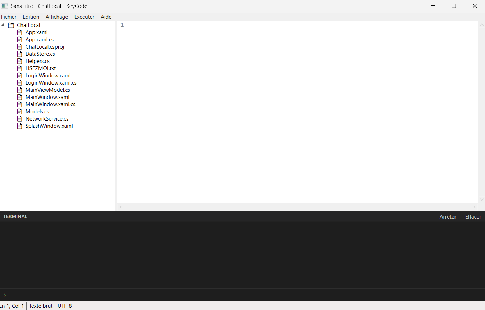

# Explorateur et recherche dans les fichiers

Auteur : erwan-rk. Fichiers : `Controls/ExplorateurControl.*` et `Controls/RechercheFichiersControl.*`.

## À quoi sert le module
- `ExplorateurControl` affiche l'arborescence d'un dossier, dans un panneau à gauche de la fenêtre.
- `RechercheFichiersControl` cherche un texte dans tous les fichiers du dossier ouvert (raccourci Ctrl+Maj+F).

## Méthodes publiques

| Contrôle | Méthode | Rôle |
|---|---|---|
| ExplorateurControl | `OuvrirDossier(string chemin)` | Affiche le dossier, met à jour `Contexte.DossierRacine`, appelle `AppEvents.SignalerDossierOuvert` |
| ExplorateurControl | `Actualiser()` | Recharge l'arborescence |
| RechercheFichiersControl | `Rechercher(string texte)` | Cherche le texte dans tous les fichiers texte de `Contexte.DossierRacine` |
| RechercheFichiersControl | `Afficher()` / `Masquer()` | Affiche ou masque le panneau de recherche |

## Fonctionnement
- **Chargement paresseux** : les sous-dossiers ne sont lus que lorsqu'on ouvre un nœud.
- **Éléments ignorés** : `bin`, `obj` et `.git`, à l'affichage et dans la recherche.
- **Double-clic sur un fichier** : `AppEvents.DemanderFichier(chemin)`. L'ouverture est faite par la fenêtre principale (puis par les onglets).
- **Menu clic droit** : nouveau fichier, nouveau dossier, renommer, supprimer (avec confirmation). Renommer et supprimer sont désactivés sur le dossier racine.
- **Recherche** : insensible à la casse. Les résultats s'affichent au format `fichier : ligne : texte`. Un double-clic sur un résultat appelle `AppEvents.DemanderFichierALaLigne(chemin, ligne)`.
- **Limites de la recherche** : 1000 résultats maximum, fichiers de plus de 2 Mo et fichiers binaires ignorés. Elle s'exécute hors du thread de l'interface pour ne pas figer la fenêtre.

## Communication avec les autres modules
- Écrit : `Contexte.DossierRacine`.
- Appelle : `AppEvents.SignalerDossierOuvert`, `AppEvents.DemanderFichier`, `AppEvents.DemanderFichierALaLigne`.
- Aucun appel direct vers un autre contrôle.

## Limite connue
`Actualiser()` reconstruit tout l'arbre : les dossiers ouverts se referment.

## Test
1. Ouvrir un dossier (Fichier, Ouvrir un dossier) : l'arborescence s'affiche.
2. Ouvrir un nœud : les sous-dossiers se chargent.
3. Clic droit : créer, renommer et supprimer un fichier.
4. Ctrl+Maj+F, chercher un mot, double-clic sur un résultat : le fichier s'ouvre à la bonne ligne.

## Capture d'écran

