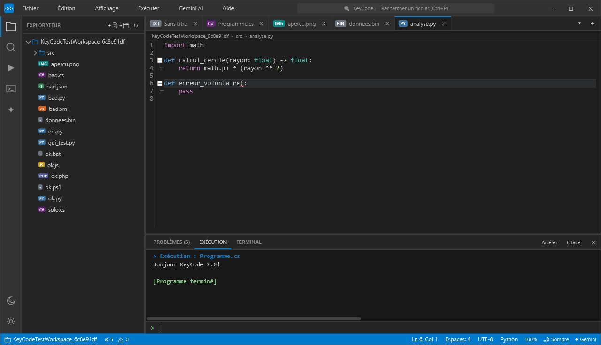
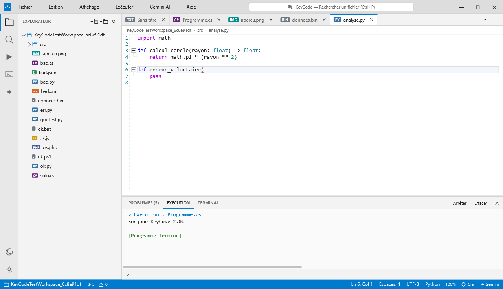

# Guide d'utilisation et de tests — KeyCode IDE 2.0

Bienvenue dans **KeyCode IDE 2.0**, l'éditeur de code en C# (WPF, .NET 10, AvalonEdit) inspiré de **Visual Studio Code** et enrichi avec **Google Gemini AI**.

---

## 1. Installation sur Windows (`KeyCodeSetup.exe`)

### Option A — Via l'installateur graphique Windows (recommandé)
1. Exécutez `powershell -ExecutionPolicy Bypass -File installer\construire-setup.ps1` depuis la racine du dépôt (ou utilisez l'exécutable généré dans `installer\dist\KeyCodeSetup.exe`).
2. Dans l'assistant **Installation — KeyCode IDE 2.0** :
   - Choisissez le dossier d'installation (par défaut `%LocalAppData%\Programs\KeyCode`).
   - Cochez les options souhaitées :
     - Raccourci sur le Bureau Windows
     - Raccourci dans le Menu Démarrer
     - Intégration au menu contextuel Windows (**« Ouvrir avec KeyCode »** sur les fichiers et dossiers)
   - Cliquez sur **Installer**, puis sur **Terminer** (avec l'option **Lancer KeyCode maintenant**).
3. Pour désinstaller proprement à tout moment : ouvrez **Paramètres Windows > Applications > Applications installées > KeyCode IDE** ou exécutez `Desinstaller-KeyCode.cmd` dans le dossier d'installation.

### Option B — Depuis le code source (.NET 10 SDK)
```powershell
cd KeyCode
dotnet run
```

---

## 2. Présentation de l'interface (style VS Code)



1. **Barre de titre personnalisée (`WindowChrome`)** :
   - Menus **Fichier**, **Édition**, **Affichage**, **Exécuter**, **Gemini AI**, **Aide**.
   - Barre centrale **Accès rapide** (`Ctrl+P`) pour ouvrir instantanément n'importe quel fichier du projet.
2. **Barre d'activité (à gauche)** :
   - **Explorateur** (`Ctrl+Maj+E`) : arborescence du dossier avec badges par extension, création de fichier/dossier, renommage, suppression et actualisation sans perdre les dossiers ouverts.
   - **Rechercher** (`Ctrl+Maj+F`) : recherche globale multi-fichiers avec ouverture directe à la ligne cliquée.
   - **Exécuter** (`F5`) : exécute le programme ou ouvre l'aperçu navigateur selon le fichier actif.
   - **Problèmes & Terminal** (`Ctrl+J`) : ouvre le panneau inférieur à 3 onglets (**PROBLÈMES**, **EXÉCUTION**, **TERMINAL**).
   - **Gemini AI** (`Ctrl+Alt+I`) : ouvre le panneau latéral droit de l'assistant IA Google Gemini.
   - Bas de barre : bascule rapide **Clair+ / Sombre+** et fenêtre **Paramètres** (taille de police, thème, clé API & modèle Gemini).
3. **Zone centrale (Onglets & Éditeur)** :
   - Barre d'onglets avec badges colorés (`C#`, `PY`, `JS`, `TS`, `RUST`, `IMG`, `BIN`...), **fil d'Ariane** du chemin actif, pliage de code, auto-complétion, fermeture automatique des parenthèses/guillemets et soulignages ondulés des erreurs.
   - **Visionneuse d'images** intégrée (`.png`, `.jpg`, `.jpeg`, `.gif`, `.bmp`, `.ico`) et **protection contre les fichiers binaires / trop volumineux**.
4. **Barre de statut (en bas)** :
   - Dossier actif, compteur cliquable d'erreurs et avertissements (`⊗ X  ⚠ Y`), position du curseur (`Ln / Col`), indentation, encodage, langage, zoom (`100%`), thème et raccourci **✦ Gemini**.



---

## 3. Configuration et utilisation de Google Gemini AI

1. Obtenez une clé API gratuite ou Pro sur **Google AI Studio** (`https://aistudio.google.com/apikey`).
2. Ouvrez le panneau **Gemini AI** (`Ctrl+Alt+I` ou bouton `✦ Gemini` dans la barre de statut), puis cliquez sur **⚙ Clé API** (ou passez par **Fichier > Paramètres...**).
3. Collez votre clé API, choisissez le modèle (`gemini-2.5-flash`, `gemini-2.5-pro` ou `gemini-2.0-flash`) et cliquez sur **Enregistrer la configuration**.
4. Utilisez les cases à cocher **Fichier actif**, **Sélection**, **Erreurs** et les boutons d'action rapide (**Expliquer**, **Corriger erreurs**, **Optimiser**, **Commenter**), ou posez une question libre.
5. Chaque bloc de code proposé par Gemini dispose de boutons **Copier**, **Insérer au curseur** et **Remplacer la sélection**.

---

## 4. Raccourcis clavier essentiels

| Raccourci | Action |
|---|---|
| `Ctrl+N` / `Ctrl+O` / `Ctrl+S` | Nouveau fichier / Ouvrir / Enregistrer |
| `Ctrl+Maj+S` / `Ctrl+W` / `Ctrl+Maj+T` | Tout enregistrer / Fermer onglet / Rouvrir dernier onglet fermé |
| `Ctrl+Tab` / `Ctrl+1..9` | Naviguer entre les onglets |
| `Ctrl+P` / `Ctrl+Maj+P` (ou `F1`) | Accès rapide aux fichiers / Palette de commandes |
| `Ctrl+F` / `Ctrl+H` / `Ctrl+G` | Rechercher / Remplacer / Aller à la ligne |
| `Ctrl+Maj+F` | Rechercher dans tous les fichiers du projet |
| `Ctrl+/` | Commenter ou décommenter la ligne / sélection |
| `Alt+↑` / `Alt+↓` | Déplacer la ligne vers le haut / le bas |
| `Ctrl+Maj+K` | Supprimer la ligne courante |
| `Ctrl+Espace` | Déclencher l'auto-complétion |
| `Ctrl+Molette` | Zoomer / dézoomer la police de l'éditeur |
| `Ctrl+Maj+E` / `Ctrl+J` / `Ctrl+Alt+I` | Basculer Explorateur / Panneau bas / Gemini AI |
| `F5` | Enregistrer automatiquement et exécuter le fichier actif |

---

## 5. Langages, coloration et exécution pris en charge

- **Coloration syntaxique (Sombre+ et Clair+)** : C#, Python, JavaScript, TypeScript, C, C++, Java, PHP, Go, Rust, HTML, CSS, XML/XAML, JSON, SQL, Markdown, YAML, PowerShell, Bash/Shell, Batch Windows.
- **Exécution console (`F5`)** : Python (UTF-8), Node.js (`.js`/`.mjs`/`.cjs`), TypeScript (`node --experimental-strip-types`), C# (projet `.csproj` ou script `.cs` autonome .NET 10), PHP, Batch Windows (`.bat`/`.cmd`), PowerShell (`.ps1`), C (`gcc`), C++ (`g++`), Rust (`rustc`), Java (`java`), Go (`go run`).
- **Exécution graphique & Web** :
  - Programmes graphiques (ex. Python `tkinter`, applications desktop C# WPF/WinForms) lancés directement avec gestion de la sortie et arrêt via **Arrêter**.
  - Pages Web (`.html`, `.htm`, `.svg`) ouvertes dans le navigateur système par défaut.
- **Diagnostics & erreurs en direct** :
  - Vérification immédiate des délimiteurs (`()`, `{}`, `[]`), JSON, XML/XAML et syntaxe Python/Node/PHP.
  - Soulignages ondulés sous les erreurs + infobulle au survol + onglet **PROBLÈMES**.
  - Dans **EXÉCUTION**, les erreurs s'affichent en rouge avec des **liens cliquables (`fichier:ligne`)** qui ouvrent l'éditeur directement sur la ligne fautive, et un bouton **✦ Corriger avec Gemini** envoie l'erreur complète à l'assistant.

---

## 6. Guide de recette et tests manuels

Cochez chaque scénario lors de la vérification manuelle :

1. **Explorateur sans plantage** :
   - Ouvrez un dossier contenant des fichiers `.cs`, `.py`, `.rs`, `.c`, `.html`, `.json`, une image `.png` et un fichier binaire (`.exe` ou `.bin`).
   - Double-cliquez successivement sur chacun : aucun plantage ; le code se colore, l'image s'affiche dans la visionneuse et le fichier binaire affiche un écran de protection lisible.
2. **Diagnostics et soulignages** :
   - Ouvrez ou créez `test_erreur.py` avec `def bug(:\n    print("test")`.
   - Vérifiez l'apparition d'un soulignage rouge ondulé sous la ligne fautive, d'une ligne dans l'onglet **PROBLÈMES** et du compteur `⊗` dans la barre de statut.
3. **Exécution console & liens cliquables d'erreur** :
   - Lancez (`F5`) un script Python valide (affichage UTF-8 correct dans **EXÉCUTION**).
   - Lancez (`F5`) un script Python levant une exception (`x = 1 / 0`) : vérifiez le texte rouge, le `[Programme terminé avec le code 1]` et cliquez sur le lien `File "...", line 1` pour vérifier le positionnement du curseur.
4. **Exécution graphique & Web** :
   - Lancez (`F5`) un script Python `tkinter` affichant une fenêtre : vérifiez l'ouverture de la fenêtre graphique puis cliquez sur **Arrêter** dans le terminal.
   - Ouvrez un fichier `.html` et appuyez sur `F5` : vérifiez son ouverture dans votre navigateur par défaut.
5. **Terminal PowerShell interactif** :
   - Basculez sur l'onglet **TERMINAL** et tapez une commande (ex. `dir` ou `python --version`) pour vérifier l'interactivité du shell intégré.
6. **Palette & Recherches** :
   - Testez `Ctrl+P` (ouverture rapide de fichier), `Ctrl+Maj+P` (palette de commandes), `Ctrl+F` / `Ctrl+H` (avec mode Regex `.*`), `Ctrl+G` (aller à une ligne) et `Ctrl+Maj+F` (recherche globale).
7. **Thèmes Clair+ / Sombre+ et persistance** :
   - Cliquez sur le bouton de thème dans la barre de statut pour alterner **Sombre** ↔ **Clair** et vérifiez la lisibilité de tous les panneaux, menus, listes déroulantes et sorties terminal.
   - Fermez et relancez KeyCode : le dossier ouvert, les onglets ouverts, le thème, la taille de police et la disposition sont restaurés.
8. **Assistant Gemini AI** :
   - Sans clé API : un message guidé claire invite à renseigner la clé Google AI Studio sans erreur bloquante.
   - Avec une clé API valide : testez **Expliquer** puis l'insertion d'un bloc de code via **Insérer au curseur**.
