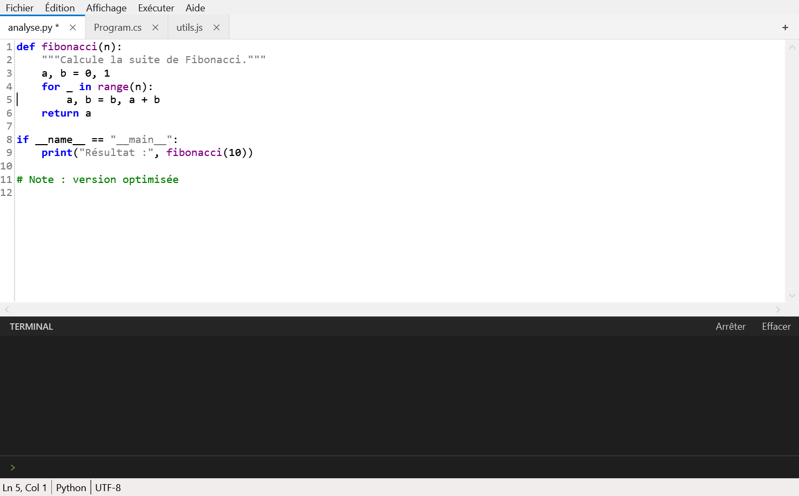

# Onglets et restauration de session (DeboraQueen237)

## Rôle du module
`OngletsControl` (`KeyCode.Controls.OngletsControl`) gère les onglets d'éditeurs de texte du cœur de KeyCode ainsi que la restauration automatique de la session au démarrage.

Chaque onglet embarque sa propre instance d'`ICSharpCode.AvalonEdit.TextEditor` configurée exclusivement via `EditeurService.Configurer(editeur, chemin)`. Le contrôle communique avec le reste de l'application uniquement via les contrats partagés `AppEvents`, `Contexte` et `SettingsService`.

## Fonctionnalités principales
- **Un éditeur par onglet** : chaque fichier ou onglet vierge conserve son historique d'annulation (`Ctrl+Z` / `Ctrl+Y`), sa position de curseur, son défilement et sa coloration syntaxique.
- **Anti-doublon à l'ouverture** : ouvrir un fichier déjà présent dans les onglets (y compris via un chemin relatif ou une casse différente sous Windows) active l'onglet existant sans perdre les modifications en cours.
- **Indicateur de modification (`*`)** : le titre de l'onglet affiche `*` dès que `TextEditor.IsModified` passe à `true`, et retire automatiquement `*` lors de l'enregistrement ou d'un retour à l'état d'origine via `Ctrl+Z`.
- **Fermeture sécurisée** : le bouton `✕`, le clic du milieu, le raccourci `Ctrl+W` ou la fermeture de la fenêtre (`PeutFermer()`) demandent confirmation (`Oui / Non / Annuler`) avant de fermer un onglet modifié.
- **Menu contextuel et ergonomie** : clic droit sur l'en-tête (`Fermer`, `Fermer les autres`, `Fermer tout`, `Copier le chemin`), bouton `+` et double-clic sur la zone libre de la barre pour créer un onglet, défilement horizontal à la molette sur la barre d'onglets, et écran d'accueil affiché lorsque tous les onglets sont fermés.
- **Adaptation au thème** : écoute `AppEvents.ThemeChange` et bascule automatiquement la palette de la barre d'onglets entre les thèmes **Clair** et **Sombre**.
- **Restauration de session** : au chargement initial, rouvre automatiquement les fichiers existants listés dans `SettingsService.DerniersFichiers` (en ignorant sans erreur les fichiers supprimés) ou ouvre un onglet vierge `Sans titre` si aucun fichier n'est à restaurer.

## Méthodes publiques (contrat)

| Méthode | Rôle |
|---|---|
| `OuvrirFichier(string chemin)` | Ouvre le fichier dans un nouvel onglet, ou active son onglet s'il est déjà ouvert. |
| `OuvrirFichierALaLigne(string chemin, int ligne)` | Ouvre le fichier puis place le curseur et défile jusqu'à la ligne demandée (indexée à partir de `1`). |
| `NouvelOnglet()` | Crée et active un nouvel onglet vide (`Sans titre`, `Sans titre 2`, etc.). |
| `FermerOngletActif()` | Ferme l'onglet actif après confirmation d'enregistrement s'il est modifié. |
| `bool EnregistrerActif()` | Enregistre l'onglet actif (ouvre `SaveFileDialog` si sans titre) et retourne `false` si l'utilisateur annule. |
| `EnregistrerTout()` | Enregistre tous les onglets modifiés en proposant un emplacement pour les onglets sans titre. |
| `bool PeutFermer()` | Vérifie tous les onglets modifiés avant fermeture de l'application ; retourne `false` si l'utilisateur annule. |
| `List<string> ObtenirCheminsOuverts()` | Retourne la liste ordonnée des chemins des fichiers actuellement ouverts. |

## Interactions avec les services partagés
- **`EditeurService.Configurer(editeur, chemin)`** : appelée systématiquement à la création de chaque `TextEditor` et lorsqu'un onglet `Sans titre` reçoit son premier chemin lors de l'enregistrement.
- **`AppEvents.FichierDemande`** : écouté pour ouvrir tout fichier demandé par l'explorateur ou par glisser-déposer.
- **`AppEvents.FichierEnregistre`** : déclenché après chaque sauvegarde réussie (`EnregistrerActif` / `EnregistrerTout`).
- **`AppEvents.ThemeChange`** : écouté pour synchroniser les couleurs de la barre d'onglets avec `ThemeManager.ThemeActuel`.
- **`Contexte.CheminActif` et `Contexte.EditeurActif`** : mis à jour à chaque changement d'onglet (ou après enregistrement d'un onglet sans titre), `CheminActif` étant toujours actualisé avant `EditeurActif` afin que `AppEvents.EditeurActifChange` fournisse un état cohérent à `RechercheControl` et à la barre de statut.
- **`SettingsService.DerniersFichiers`** : lu au démarrage pour restaurer la session et mis à jour (10 fichiers maximum) à l'ouverture et à l'enregistrement.

## Raccourcis et gestes pris en charge
| Raccourci / Geste | Action |
|---|---|
| `Ctrl+Tab` | Passer à l'onglet suivant (boucle au premier onglet) |
| `Ctrl+Maj+Tab` | Passer à l'onglet précédent (boucle au dernier onglet) |
| Clic sur `+` ou double-clic sur la barre libre | Ouvrir un nouvel onglet vierge |
| Clic sur `✕` ou clic du milieu sur un onglet | Fermer l'onglet ciblé |
| Clic droit sur un onglet | Menu contextuel (`Fermer`, `Fermer les autres`, `Fermer tout`, `Copier le chemin`) |
| Molette sur la barre d'onglets | Faire défiler horizontalement les onglets |

## Capture d'écran

